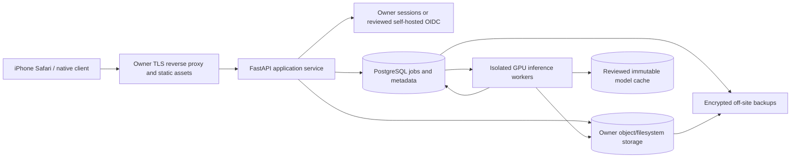

# DragonFly Self-Hosting Architecture

Status: owner-controlled target design, **not a deployed implementation**. Date: 2026-10-21. Current production remains on Render/Replicate and is intentionally unchanged. See [dependency audit](DRAGONFLY_DEPENDENCY_AUDIT.md) for actual implementations and license evidence.

## Goals And Boundaries

Operational independence means normal capture, inference, editing, account access and exports can run on infrastructure controlled by the owner without mandatory third-party AI APIs or SaaS subscriptions. It does not mean owning every OS, GPU driver, browser, library, dataset, model patent or upstream trademark. Hardware, power, bandwidth, support, domain registration and possibly signing/legal licenses still cost money.

Do not remove Replicate, alter production defaults, turn on segmentation, migrate user data, change Render configuration, or ship a new engine as part of this foundation. A later authorized transition must have rollback and independently verified quality. The evaluation branch remains `experimental/reconstruction-evaluation`, independently preserved, not merged into this branch.

## Inspected Architecture To Reuse

- `ReconstructionProvider.generate(ReconstructionRequest, models_dir) -> ReconstructionOutput` already provides a synchronous engine boundary. Replicate, TripoSR and DPT implementations exist, plus procedural and unavailable-provider paths. No refactor of this working dispatcher is necessary now.
- `_run_generation` owns job progress, memory-safe preparation, reconstruction and response URLs; `JOBS` is currently in process memory. `PREPROCESSING_LOCK` serializes local preparation inside one process, not across machines.
- `physical_units.py` owns calibration, scale sidecars, GLB meter representation and STL millimeters; `mesh_editing.py` owns deterministic edits/Boolean operations and print checks. Preserve their APIs and sidecars, including base-source revision references.
- The Expo Zustand history retains model revision URLs. Undo/redo/reset must continue to select immutable revisions; a storage migration cannot overwrite earlier URLs or reset calibration.
- Active viewer uses `model-viewer` from unpkg at runtime; future owner-bundled assets need independent browser tests. The separate broader API's PostgreSQL/queue/auth helpers are prototypes, not a finished data plane.

## Target Components

| Component | Owner-controlled starting point | License / operational caveat |
|---|---|---|
| Static frontend / edge | Versioned Expo web export; nginx or Caddy on owner Linux | nginx BSD-2-Clause / Caddy Apache-2.0 upstream declarations; pin exact binaries/notices before adoption. No mandatory CDN. Native iOS still needs platform compliance |
| API | Existing FastAPI/Uvicorn app, supervised by systemd or owner containers | Preserve HTTP contracts; add authentication/durable jobs through separate tested migration, not a rewrite |
| GPU inference | Dedicated NVIDIA Linux host or owner-administered VM, one model execution process per admitted GPU slot | GPU/driver/CUDA licenses and exact compatibility reviewed; 512 MB Render instance is not a GPU worker. No GPU purchased or provisioned here |
| Database | PostgreSQL on private network, migrations, TLS and least-privilege roles | PostgreSQL permissive license; proposed, not currently implemented in the active API |
| Object store | Start with a durable encrypted filesystem/HTTP artifact gateway; scale to a reviewed S3-compatible service if needed | Avoid adding an object-storage SaaS dependency. Evaluate chosen S3-compatible implementation/license/version separately; MinIO/other AGPL or source-available terms are not assumed equivalent to S3 |
| Queue | PostgreSQL transactional job table, leases and `SKIP LOCKED` workers | Avoid mandatory broker for first owner deployment. If justified later, RabbitMQ/Valkey licenses and operational costs need a separate review; Redis branding/version is not a universal permissive-license guarantee |
| Authentication | Reviewed owner session service with Argon2id or established self-hosted OIDC (e.g. reviewed Keycloak) | Keycloak upstream Apache-2.0 declaration; not installed. Legacy JSON sessions are not production assurance. Email delivery can be owner-operated but deliverability/abuse remain real costs |
| Monitoring | Structured local logs, OS/process/GPU metrics, optional reviewed Prometheus/Grafana stack | Prometheus Apache-2.0 / Grafana AGPL variants require exact-version review; monitoring SaaS not required |
| Build / registry | Owner Git, CI runner, OCI/wheel/npm/model mirrors | Pin hashes, retain SBOM/NOTICE and signatures. Avoid executing mutable remote model code during inference |
| Backups | Owner encrypted backup target plus independently controlled off-site replica | Backup tool/crypto/license selection and key recovery tested; no single physical site or storage replica constitutes disaster recovery |

Every optional named target is a design choice, not an installed service or automatic commercial approval. Prefer a small supervised deployment over a compulsory Kubernetes platform until scale requires orchestration.

## Local GPU Adapter Contract

New standalone definitions live in `eye-platform-alpha-geometry-backend/geometry-backend/app/local_inference_contract.py`. They are not imported by production provider selection and do not implement a model or launch subprocesses.

| Contract | Required behavior |
|---|---|
| `ModelIdentity` | Stable model ID, immutable revision, actual weight SHA-256, weight-license source and explicit commercial review decision. Repository commit alone is not a weight-file checksum; license review is not granted by this dataclass |
| `LocalInferenceRequest` | Stable idempotency/request identity, bounded image file, expected image SHA, model identity and explicit engine parameters. `validate_input()` checks file size/hash/type/pixel limit without transforming the source; worker authorization and object ownership remain separate requirements |
| `LocalGPUInferenceAdapter.submit` | Validate rights, content policy, caller access, capacity and input before accepting. Return stable job ID; repeated idempotency key+hash must resolve to the same job, not duplicate GPU work. Reject changed payload under an existing key |
| `status` | Typed queued/loading_model/running/exporting/complete/failed/cancelled states, progress, safe error and resource snapshot. Polling must work across API/worker restarts using durable state |
| `cancel` | Cooperative cancellation followed by bounded hard process termination if necessary; no partial artifact published. Idempotent after terminal state |
| `resources` / `ResourceSample` | Timestamped sampling in implementation of host RSS, GPU allocated/used/total VRAM, elapsed time and device; unsupported counters remain null, never fake zeros. Dataclass rejects negative/nonfinite values |
| `InferenceError` | Stable codes such as INVALID_IMAGE, MODEL_LICENSE_DENIED, MODEL_UNAVAILABLE, GPU_OOM, TIMEOUT, CANCELLED, INVALID_GLB and STORAGE_ERROR; safe client text, private detailed diagnostics and explicit retryability |
| `GLBArtifact` | Immutable local/object artifact, SHA, input SHA, model identity and real execution receipt. `validate_container()` only checks header/version/length/hash. It **does not prove a valid glTF scene, AI execution, visual fidelity or printability** |
| `InferenceStatus.COMPLETE` | Requires artifact, progress 100, no error, and matching container hash/header. Actual implementation must additionally validate complete scene/mesh, storage integrity and execution provenance before constructing completion |

The tests use a deliberately fake GLB-header fixture and fake execution identity to exercise container/status validation. They are **not successful AI inference tests**. A future implementation must not create that status from procedural geometry, a mock, a depth relief or a cached unrelated object. No contract can cryptographically establish honest model execution merely from caller-supplied metadata; use trusted worker identities, signed manifests/logs and controlled executables.

### Future Compatibility Bridge, Not Enabled Now

An authorized `SelfHostedProvider.generate` implementation can translate the existing `ReconstructionRequest` to this lifecycle API, poll a durable job, obtain the validated artifact, and return the existing `ReconstructionOutput(provider_kind="ai")`. It must preserve the exact input/preparation manifest and pin engine/version/seed/options. Do not add this to `select_provider()` until real GPU tests pass. Never silently switch engines or procedural fallback on inference failure. The existing Replicate adapter stays selectable and unchanged throughout qualification.

## Job And Artifact Protocol

1. Accept a bounded upload, preserve consent and source hash, apply the existing EXIF/resize/RGB preparation policy, and record the submitted image hash separately. Optional experimental isolation requires separate approval and evidence; do not couple it to hosting migration.
2. Store source/prepared objects with tenant identity and retention policy. Enqueue a database transaction containing job UUID/idempotency key, model revision+hash, parameters, consent reference, timestamps and budgets. API returns accepted immediately; no GPU import in the API process.
3. Worker claims a lease transactionally, verifies input hash and reviewed local model manifest, and publishes bounded status updates/heartbeats. Reject overload rather than launch unlimited processes. Queue work never contains arbitrary shell commands or unrestricted download URLs.
4. Execute the reviewed model using a preinstalled runtime and no outbound internet. Separate shape/texture/postprocess stages and license manifests. Restrict file paths to job-owned scratch directories; cap decoded pixels, disk, runtime, host RAM and VRAM.
5. Validate full output with trusted glTF/mesh tooling. Record vertex/face counts, topology and plausible-bounds warnings without claiming fidelity. A single watertight fused artifact can still be a bad reconstruction. Retain raw output and transformation receipts for diagnosis.
6. Atomically publish immutable GLB and optional STL plus calibration/feature/provenance sidecars. Preserve model URL semantics, MIME, CORS, byte range support and sufficient signed URL lifetimes. Never serve local execution paths as remote arbitrary-file reads.
7. Mark complete only after durable metadata/artifact commit. Upload/download or validation failure stays failed, not success. Retry only idempotently and only under explicit budgets; preserve failed/pending receipts so a restart does not double-execute.

Prototype job storage must be migrated before horizontal scaling. Proposed database tables include users/sessions, objects/versions/access grants, reconstruction jobs/events/leases, model manifests, calibration/revision links, consent receipts and deletion requests. Schema/migrations have not been implemented here.

## Resource Isolation And Capacity

- The 512 MB production HTTP service stays lightweight. Previous local U2Net preprocessing exceeded its limit; local segmentation remains disabled in production. Do not place PyTorch/CUDA model loading back into that process.
- GPU worker capacity is measured, not inferred from a vendor README. TripoSR documents about 6 GB VRAM, TripoSG at least 8 GB and TRELLIS at least 16 GB, but peak memory includes preprocessing, decoder, textures, native extensions and concurrent jobs. Acquire/test hardware only with authorization.
- Use explicit systemd/cgroup/container memory, CPU, GPU-device and scratch-disk limits; account for GPU reserved as well as allocated memory. Host RSS and worker peaks must be reported separately from API RSS. A preflight allowance is not a live guarantee.
- Start with one admitted job per measured device slot. Use bounded queues, backpressure and workload classes rather than killing healthy API workers. GPU OOM should fail the job, clean scratch memory/processes and leave service health intact.
- Prefer worker process isolation where native memory is retained; benchmark model warm-cache versus cold-start behavior and safe restart. Cache only reviewed immutable weights, not arbitrary user images indefinitely.
- Capture p50/p95 latency, queue wait, peak host/VRAM, failures, cancellation latency, disk growth, power and dollars/job. Independence is a cost/reliability tradeoff, not zero-cost inference.

## Security, Identity And Networking

- TLS only on public edge; private GPU/DB/object networks. Authenticate API-to-worker requests (mTLS or short-lived service credentials); no public GPU control port. Object URLs require authorization and expiry, not UUID secrecy alone.
- Least-privilege per-tenant objects and immutable model artifacts. Reject SSRF/unsafe URLs, path traversal, malformed scene parsers, oversize image bombs and untrusted model deserialization. Review checkpoint formats; prefer audited safe formats, disable unnecessary `trust_remote_code`, and never execute uploaded files.
- Replace prototype local session records through a reviewed migration: secure password hashing, session expiry/revocation, HttpOnly/Secure/SameSite cookies or carefully scoped tokens, CSRF protection, rate limiting, account recovery and audit events. Authentication is not accomplished simply by installing a database.
- Do not expose inference tokens in Expo public variables. The active classification path has no OpenAI requirement; the legacy duplicate's public-key pattern must not be reintroduced.
- Serve reviewed JS, WASM, glTF decoders, fonts/icons and artifacts from owner origins to remove runtime CDN dependence. Test with outbound traffic blocked; account for browser caches and service-worker upgrades.
- DNS/domain registration, public certificate issuance and iOS distribution/signing still have external trust constraints. For offline/private use, owner DNS/private CA deployment requires explicit device trust and security review. Do not claim independence from browser/OS/hardware suppliers.

## Backups, Retention And Recovery

Proposed initial operational objectives (not achieved SLAs): database RPO <=24 hours/RTO <=4 hours; published artifact versions retained through all user-visible edit history; backup restore drill at least monthly before public migration. Owner must approve actual targets against storage/cost/legal requirements.

Use consistent DB backups/WAL policy and object-version snapshots, with encrypted off-site copies and separately stored recovery keys. Test restore into a clean isolated host, including calibration millimeters, base-source pointers, model revisions, accounts, consents and tombstones. A mirrored deletion must not silently destroy the last authorized backup, but privacy deletion must have a documented retention completion deadline. Logs/debug photos are not automatically permanent records or training assets.

## Staged Transition And Rollback

| Stage | Required evidence before advancing |
|---|---|
| Foundation (this branch) | Dependency/legal audit, inactive adapter contract, CPU/no-cost tests; no runtime/Render changes |
| Owner lab | Authorized hardware and model download, reviewed weights/auxiliary code, offline one-photo AI inference and true GLB loading; record exact versions/receipt/resources |
| Quality qualification | Approved paired real-camera data across opaque/transparent/reflective/geometric/irregular categories; comparable input/settings; mask/detail/fidelity human review, not just mesh validity |
| Data plane staging | Durable job recovery, tenant authorization, storage URL compatibility, backup restore and failure injection; no production traffic |
| Compatibility staging | Existing reconstruction/edit/calibration/mm/history/export/manufacturing tests plus actual iPhone/Mobile Safari viewer and download behavior; texture/coordinate/units checks |
| Explicit owner-approved canary | Versioned routing by opt-in, metrics/cost caps and one-step rollback to unchanged Replicate; never treat a self-hosted failure as procedural AI success |
| Explicit owner-approved migration | Stable quality/availability/cost, legal approval and offline/egress test. Retain recoverable history and old artifacts; avoid deleting keys/checkpoints until rollback window and user consent permit |

Required failure tests include GPU OOM, invalid image/GLB, worker death after model run but before publication, duplicate submit, cancellation, stale lease, full disk, expired output URL, network split, interrupted DB migration, backup restore and mixed-version rollback. None of these GPU/distributed tests were performed in this foundation; local contract tests are not substitutes.

The separate Docker Compose example targets the broader API/Next app, not the active geometry/Expo deployment. It is reference material, not an owner-hosting implementation of this design. No new mandatory service or infrastructure cost was introduced.